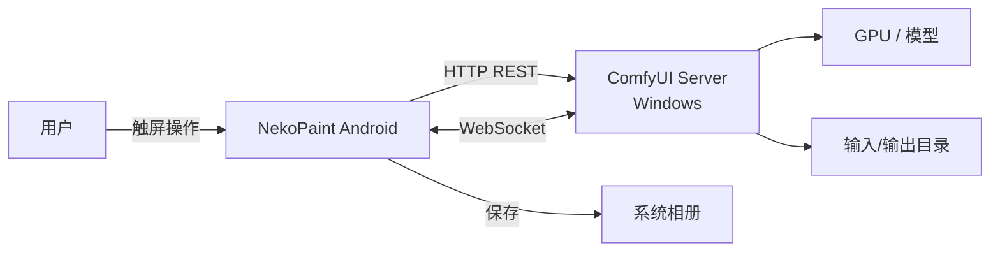
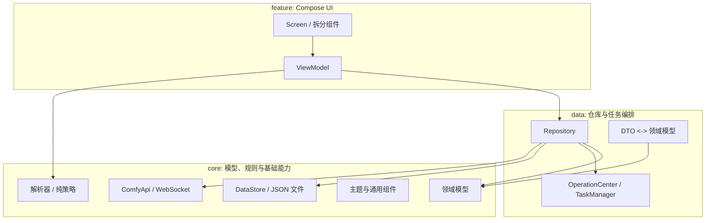
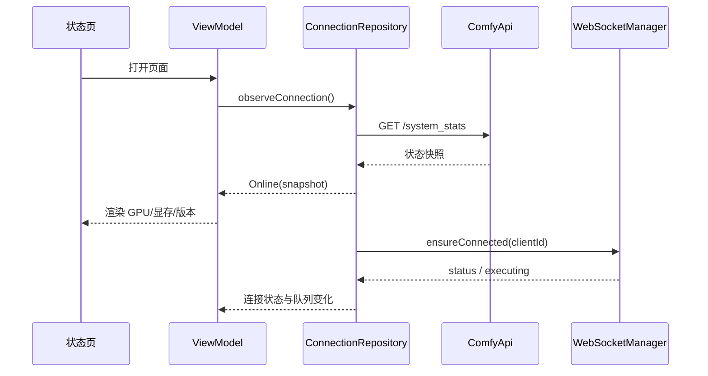
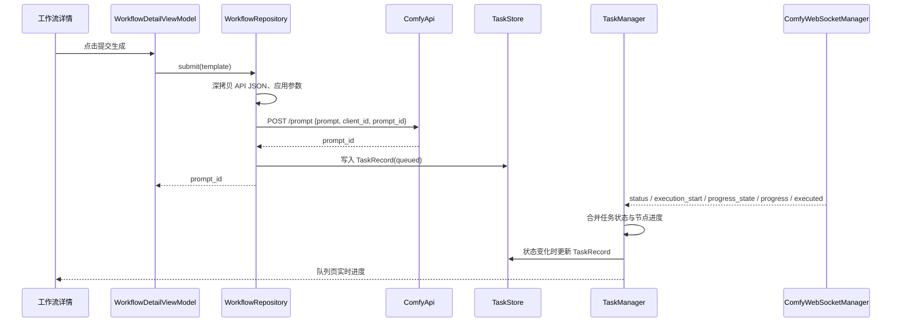
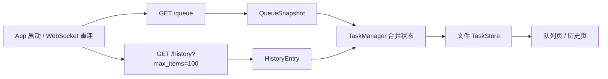

# ARCHITECTURE.md

> 技术架构与工程结构
>
> - 版本：v0.1（草案）
> - 更新：2026-11-04
> - 状态：待项目负责人确认
> - 关联文档：`REQUIREMENTS.md`、`COMFYUI_API.md`、`DECISIONS.md`

---

## 1. 架构目标

1. 手机只做“控制与展示”，所有生成在 Windows 的 ComfyUI 上完成。
2. 网络、数据、UI 分层，避免 Activity/Fragment 里堆逻辑。
3. 对 ComfyUI 版本差异保持容错：字段缺失不崩溃，能力不支持时降级。
4. 单模块即可维护；不为未来可能的需求提前拆多模块。
5. 每个阶段都能独立构建、运行、验收。

### 关键约束

- Android 原生：Kotlin + Jetpack Compose + Material 3。
- 局域网直连 ComfyUI，无中转服务。
- 最低 Android 8.0（API 26），目标 API 37。
- V1 不引入账号体系、云端、数据库服务端。

---

## 2. 系统上下文



- App 与 ComfyUI 在同一局域网。
- ComfyUI 默认端口 `8188`，通过 `--listen` 暴露到局域网。
- 无额外后端、无云服务。

---

## 3. 技术选型

| 领域 | 选型 | 状态 | 说明 |
| --- | --- | --- | --- |
| 语言 | Kotlin 2.x | 确定 | Android 官方主推 |
| UI | Jetpack Compose + Material 3 | 确定 | 声明式 UI，适合状态驱动 |
| 导航 | Navigation Compose | 建议 | 单 Activity，多 Composable 页面 |
| 异步 | Coroutines + Flow | 确定 | 结构化并发，替代回调 |
| 状态 | ViewModel + StateFlow + UDF | 建议 | UI 状态不可变，事件单向 |
| HTTP | Retrofit + OkHttp | 建议 | 成熟、资料多；WebSocket 复用 OkHttp |
| JSON | kotlinx.serialization | 建议 | 与 Kotlin 类型安全结合，容错配置方便 |
| WebSocket | OkHttp WebSocket | 建议 | 与 HTTP 共用连接池与超时配置 |
| 图片加载 | Coil 3 | 已实施（V0.4a） | Compose 友好，支持磁盘/内存缓存与采样；复用 OkHttpClient |
| 本地配置 | DataStore (Preferences) | 已实施 | 服务器、设置、AI 配置与客户端身份 |
| 结构化数据 | JSON 文件 + `AtomicFileWriter` | 已实施 | 模板、任务、历史；Room 未引入 |
| 依赖注入 | 手动 `AppContainer` | 已实施 | 单模块，构造注入；规模变大再评估 Hilt |
| 测试 | JUnit + MockWebServer + Compose UI Test | 已实施 | 解析器/策略/仓库优先，API28 instrumentation 兜底 |
| 构建 | Gradle Kotlin DSL + Version Catalog | 已实施 | `libs.versions.toml` 统一版本 |

> 版本号不在文档中写死；统一记录在 `gradle/libs.versions.toml`。
> 替代方案与理由见 `DECISIONS.md`。

---

## 4. 应用分层



当前实际实现为单模块、手动依赖注入（`di/AppContainer`），没有单独 `domain` 层：

- `feature` 依赖 `data` 仓库与 `core` 的模型/策略/UI 组件；页面状态由 ViewModel 暴露。
- `data` 负责模板、任务、历史、节点目录、服务器与提交流程，依赖 `core/network`、DataStore、私有目录 JSON 和 MediaStore。
- `core/network` 只放传输、DTO、超时与日志脱敏；业务规则放在 `core/workflow` 或 `data/repository`。
- `core/workflow` 放可 JVM 单测的解析、参数识别、兼容性分析、catalog 与提交/重试策略。
- 持久化不使用 Room：服务器/设置用 DataStore，模板/任务/历史用 `filesDir` 下的 JSON + `AtomicFileWriter`，图片走 MediaStore/应用缓存。
- UI 不直接接触 DTO；由 mapper 转为领域模型。
- ViewModel 不持有 `Context`、`Activity`、`View`；需要应用上下文的存储由仓库接收 `applicationContext`。
- 大页面按职责拆为同包文件（Chat/WorkflowDetail/History 均保留入口文件 + 列表/表单/对话框组件），单文件目标 <800 行。

### 为什么不用多模块

当前只有一名开发者、一个 App、一个数据源。多模块会增加构建配置与依赖管理成本，收益不足。
当出现以下情况再拆分：第二个客户端、复杂后台服务、构建时间明显变长、多人并行开发。

---

## 5. 当前目录结构

> 以下为当前实际结构（省略 `res/`、`test/` 与 `androidTest/` 的逐文件展开）。

```text
NekoPaint/
├─ app/
│  └─ src/main/java/io/github/xiaowu20245/nekopaint/
│     ├─ NekoPaintApplication.kt
│     ├─ MainActivity.kt
│     ├─ di/AppContainer.kt          # 手动依赖注入
│     ├─ core/
│     │  ├─ common/                  # NekoMessage、通用结果与常量
│     │  ├─ datastore/               # 服务器、设置、AI 配置
│     │  ├─ image/                   # 图片头解析、编码与采样
│     │  ├─ model/                   # 服务器/工作流/任务/AI 领域模型
│     │  ├─ network/                 # ComfyApi、DTO、OkHttp、WebSocket
│     │  ├─ privacy/                 # 诊断与隐私脱敏
│     │  ├─ security/                # Keystore / SecretCipher
│     │  ├─ ui/                      # 主题、通用组件、图标、导航
│     │  └─ workflow/                # 解析、参数识别、兼容性、catalog、策略
│     ├─ data/
│     │  ├─ mapper/                  # DTO <-> 领域模型
│     │  ├─ operation/               # 批量提交与 OperationCenter
│     │  └─ repository/              # 模板/任务/历史/服务器/节点/模型仓库
│     └─ feature/
│        ├─ chat/                    # Neko I 会话、工具、动作卡片
│        ├─ common/                  # 用户文案映射
│        ├─ generate/                # 提交与批量生成
│        ├─ history/                 # 历史列表、筛选、详情、选择
│        ├─ queue/                   # 队列与进度
│        ├─ server/                  # 服务器配置与状态
│        ├─ settings/                # 设置、AI 服务、词库
│        └─ workflow/                # 工作流列表、导入、详情、蒙版
```

大页面采用同包拆分，入口文件只保留组合、入口与预览：

- `feature/chat/ChatScreen.kt` + `ChatMessageList.kt`、`ChatComposer.kt`、`ChatActionCard.kt`、`ChatSessionSheet.kt`、`ChatDialogs.kt`。
- `feature/workflow/WorkflowDetailScreen.kt` + `WorkflowDetailHeader.kt`、`WorkflowParameters.kt`、`WorkflowParameterFields.kt`、`WorkflowPresetBar.kt`、`WorkflowInstallDialog.kt`。
- `feature/history/HistoryScreen.kt` + `HistoryFilters.kt`、`HistoryList.kt`、`HistoryDialogs.kt`、`HistorySelectionBar.kt`。
- 单文件目标 <800 行；跨文件同包访问使用 `internal`，仅本文件使用保持 `private`。

### 包名

已确认：`io.github.xiaowu20245.nekopaint`（见 `DECISIONS.md` D-018）。

### 主导航

底部固定四个板块：

| 板块 | 职责 |
| --- | --- |
| 服务器 | 连接配置、在线状态、GPU/显存 |
| 工作流 | 模板列表、导入、详情、参数入口 |
| 队列 | 运行中/等待中任务，历史入口 |
| 设置 | 主题、缓存、安全提示、关于 |

“生成”和“历史”不作为底部 tab：生成从工作流详情进入，历史从队列页进入。顶部 App Bar 只显示当前板块标题；V0.1 可在右侧增加连接状态小圆点。

---

## 6. 核心数据流

### 6.1 连接与状态



要点：

- HTTP 用于一次性快照；WebSocket 用于持续事件。
- App 回到前台触发一次健康检查；离开页面停止轮询。
- 连接状态由 Repository 统一维护，多个页面共享同一个 `StateFlow`。

### 6.2 提交任务与实时进度（V0.3 已实施）



要点：

- 提交前深拷贝模板 JSON，应用参数后提交，绝不修改原模板。
- `client_id` 由 `ClientIdStore` 持久化，POST 与 WebSocket 共用同一个值。
- `TaskManager` 是单例（在 `AppContainer` 中创建），统一处理 WebSocket 事件、队列快照和历史快照。
- 进度以 `progress_state` 为主、`progress` 为细粒度补充，`executing` 提供当前节点。
- 任务状态只允许单向收敛：`queued → running → success / failed / interrupted`。

### 6.3 队列、历史与恢复（V0.3 已实施）



- 服务器队列与历史是最终事实来源；本地 `TaskRecord` 保存提交参数快照与名称。
- 断线时队列页降到 2 秒轮询；重连成功后主动刷新一次。
- 历史状态同时看 `status_str` 和事件消息：`execution_interrupted` 优先于 `status_str=error`，避免把中断误判成失败。
- 历史详情支持用参数快照“再次生成”，新任务不会覆盖原历史。

---

## 7. 网络层设计

### 7.1 Base URL 与 Retrofit

- 用户配置保存为 `scheme`、`host`、`port`，运行时拼成 `http://host:port/`（Retrofit 要求尾斜杠）。
- 配置变化时重建 Retrofit 实例；共享 OkHttpClient。
- IPv6 主机需要方括号：`http://[fe80::1]:8188/`。
- 不使用全局单例保存旧地址，避免切换服务器后请求打错目标。

### 7.2 API 接口（计划）

```kotlin
interface ComfyApi {
    @GET("system_stats")
    suspend fun systemStats(): SystemStatsDto

    @GET("queue")
    suspend fun queue(): QueueDto

    @GET("history")
    suspend fun history(
        @Query("max_items") maxItems: Int? = null,
        @Query("offset") offset: Int? = null,
    ): Map<String, HistoryItemDto>

    @GET("history/{promptId}")
    suspend fun historyItem(@Path("promptId") promptId: String): Map<String, HistoryItemDto>

    @POST("prompt")
    suspend fun submitPrompt(@Body body: PromptRequestDto): PromptResponseDto

    @POST("interrupt")
    suspend fun interrupt(@Body body: InterruptRequestDto): Response<Unit>

    @POST("queue")
    suspend fun updateQueue(@Body body: QueueOperationDto): Response<Unit>

    @GET("view")
    suspend fun viewImage(
        @Query("filename") filename: String,
        @Query("subfolder") subfolder: String?,
        @Query("type") type: String?,
    ): ResponseBody

    @GET("object_info")
    suspend fun objectInfo(): Map<String, NodeInfoDto>

    @GET("models")
    suspend fun modelFolders(): JsonElement

    @GET("models/{folder}")
    suspend fun models(@Path("folder") folder: String): JsonElement
}
```

模型列表在不同版本可能是裸数组或 `{value:[...],Count:n}`，因此保留 `JsonElement`，由 `ModelListParser` 统一解析。
`ModelsRepository` 按加载器映射目录（checkpoints/loras/vae/diffusion_models...），缓存到 `filesDir/models/catalog.json`，失败时用缓存或保持文本输入。

约定：

- 错误响应体需要解析时使用 `Response<T>` 或捕获 `HttpException` 后读取 `errorBody`。
- JSON 配置 `ignoreUnknownKeys = true`、`isLenient = true`、`explicitNulls = false`。
- 所有 DTO 字段按“可能缺失”设计，不假设版本一致。
- 图片下载使用独立 OkHttp 请求或 Coil，不经过 JSON 解析。

### 7.3 超时与重试

| 项目 | 值 | 说明 |
| --- | --- | --- |
| 连接超时 | 5s | 局域网应很快 |
| 普通读取 | 15s | `/prompt` 校验可能稍慢 |
| 图片下载 | 30s | 大图 |
| WebSocket 心跳 | 20s | OkHttp `pingInterval` |
| WS 重连退避 | 1, 2, 4, 8, 16, 30s | 加 0–500ms 抖动 |
| 状态轮询 | 5s | 仅页面可见时 |
| 队列降级轮询 | 2s | WS 不可用时 |

只对幂等 GET 自动重试；`POST /prompt` 不自动重试，除非能保证幂等（客户端 `prompt_id`）。

### 7.4 WebSocket 管理

职责：

- 使用配置生成 `ws://host:port/ws?clientId=<uuid>`（HTTPS 时 `wss://`）。
- 维护连接状态：`Disconnected / Connecting / Connected / Reconnecting`。
- 解析文本事件与二进制预览帧；未知事件忽略并记录 Debug 日志。
- 断线重连；重连后重新拉取队列与历史。
- 页面不可见时暂停轮询；WebSocket 保持应用级连接。
- 提供 `Flow<ComfyEvent>` 给 `TaskManager`。
- 事件解析已拆到 `ComfyEventParser`，坏 JSON / 未知事件返回 `null`，二进制帧直接忽略。

关键点：

- **clientId 必须与提交任务时的 `client_id` 一致。** 否则服务端只把事件发给提交者，App 会“看不到自己的任务”。
- 服务端在连接建立时发送 `status`；重连时若当前执行客户端是自己，会补发 `executing`。
- 0.27.0 会发送 `progress_state`（节点状态累计快照）；App 以它作为节点状态主来源，`progress` 作为细粒度补充。
- 二进制帧格式：4 字节事件类型 + 数据。`1` = 预览图（4 字节图片类型 + 图片字节，1=JPEG、2=PNG）；`3` = 文本；`4` = 带元数据预览。V0.3 可先忽略二进制帧。

### 7.5 错误模型

```kotlin
sealed interface AppError {
    data object NoServerConfigured : AppError
    data object NetworkUnreachable : AppError
    data object Timeout : AppError
    data class Http(val code: Int, val message: String?) : AppError
    data class ServerValidation(val summary: String, val nodeErrors: List<NodeError>) : AppError
    data class Parse(val detail: String) : AppError
    data class Unknown(val detail: String) : AppError
}
```

- Mapper 将异常/HTTP 状态转为 `AppError`，ViewModel 再映射为中文文案。
- 不在 UI 直接显示异常堆栈。
- 诊断信息可复制，但移除服务器地址、提示词正文、图片路径。

---

## 8. 状态管理

### 8.1 单向数据流

```kotlin
data class ServerUiState(
    val connection: ConnectionUiState = ConnectionUiState.Loading,
    val stats: SystemStats? = null,
    val lastUpdated: Instant? = null,
    val isRefreshing: Boolean = false,
)

sealed interface ServerEvent {
    data class ShowMessage(val message: String) : ServerEvent
    data class Navigate(val route: Route) : ServerEvent
}
```

- ViewModel 暴露 `StateFlow<UiState>` 与 `SharedFlow<Event>`。
- Composable 只渲染状态、发送意图，不直接调用 Repository。
- 一次性提示（Snackbar、跳转）用事件，避免旋转屏幕重复弹出。

### 8.2 共享状态

跨页面共享：

- 当前服务器与连接状态（`ConnectionRepository`）。
- 当前模板草稿（`DraftRepository` 或数据库）。
- 正在运行的任务（`TaskRepository`）。

每个页面只订阅自己需要的切片，避免一个大 `AppState` 引发全量重组。

---

## 9. 持久化设计

### 9.1 DataStore

保存轻量配置：

- 服务器列表 JSON（`servers_json`）与当前服务器 ID（`active_server_id`）。
- 旧单服务器字段保留用于一次性迁移。
- 主题模式、动态取色开关。
- 是否已看过安全提示/引导。
- 缓存上限。

### 9.2 模板存储（V0.2a 已实施）

模板 JSON 与参数绑定暂存文件系统：

```text
filesDir/workflows/<templateId>/api.json      # 原始 API JSON，只读（全局共享）
filesDir/workflows/<templateId>/profile.json  # 名称、哈希、候选参数、选中状态（全局共享）
filesDir/servers/<serverId>/tasks/<promptId>.json    # 任务记录
filesDir/servers/<serverId>/history/history.json     # 历史元数据缓存
filesDir/servers/<serverId>/models/catalog.json      # 模型目录缓存
```

选中的参数就是简单模式显示的字段；高级模式读取同一份 `profile.json` 的全部候选。
任务记录在状态变化时由 `TaskManager` 更新，应用重启后重新读取。
固定 `client_id` 保存在独立 DataStore（`client_identity`），不写入模板文件。
历史元数据由 `HistoryStore` 按服务器缓存：启动先展示缓存，`/history` 成功返回后覆盖并写盘；失败时保留缓存并标记过期。
Room 仍未引入；历史列表优先使用服务器数据，本地文件和 Coil 图片缓存用于重启/短时离线查看。切换服务器时 `TaskManager` 清空内存队列/进度并按新 `serverId` 重新加载缓存。

### 9.3 结构化存储（未引入 Room）

当前不使用 Room。模板、绑定、任务、历史分别以 JSON 文件存放在 `filesDir`，写入使用 `AtomicFileWriter` 保证原子性；服务器/设置使用 DataStore。

- 模板：`filesDir/workflows/<templateId>/api.json` + `profile.json`。
- 任务：`filesDir/servers/<serverId>/tasks/<promptId>.json`。
- 历史：`filesDir/servers/<serverId>/history/history.json`。
- 模型目录：`filesDir/servers/<serverId>/models/catalog.json`。
- 图片缓存由 Coil 管理（`cacheDir/image_cache`）；分享临时文件在 `cacheDir/share`；保存到相册时走 MediaStore。

若后续需要跨表事务或复杂查询，再评估 Room；当前不为未实施 schema 维护文档。

### 9.4 数据保留

- 历史元数据默认保留最近 200 条，超出按时间清理。
- 图片磁盘缓存上限 500 MB、内存缓存 25%，由 Coil 管理。
- 设置页提供缓存统计与“清理缓存”，不删除相册图片。

---

## 10. 工作流模板与参数绑定

### 10.1 导入

1. 通过 SAF 读取文件流（限制大小）。
2. 解析为 `JsonObject`。
3. 判断格式：
   - API 格式：所有 value 是对象且含 `class_type`。
   - UI 格式：含 `nodes` 数组与 `links` 数组。
4. API 格式写入文件并生成模板记录；UI 格式拒绝并给出导出指引。
5. 运行只读兼容性分析（`WorkflowCompatibilityAnalyzer`）：
   - 识别文生图/图生图/蒙版重绘/自动部位重绘
   - 找出已连接的外部图片槽和蒙版槽
   - 检查必需输入、孤立 LoadImage、UI 占位值、缺失节点类型
   - 报告保存到模板 `compatibility`；旧模板首次打开时补分析
6. App 不插入、删除、重接或替换节点；只填写已有输入和顶层请求字段。

### 10.2 绑定模型

```kotlin
data class ParameterBinding(
    val id: String,
    val nodeId: String,
    val inputName: String,
    val label: String,
    val type: ParameterType,
    val group: ParameterGroup,
    val defaultValue: JsonElement,
    val constraints: ParameterConstraints,
)

enum class ParameterType { TEXT, MULTILINE_TEXT, INT, FLOAT, BOOLEAN, ENUM, IMAGE }

data class ParameterConstraints(
    val min: Double? = null,
    val max: Double? = null,
    val step: Double? = null,
    val options: List<String> = emptyList(),
)
```

- 绑定按 `nodeId + inputName` 定位，节点标题只用于展示。
- 自动识别使用 `class_type` 白名单；无法识别时允许手动添加。
- 应用参数时校验类型：文本→String，整数→Int/Long，小数→Double，枚举→String，布尔→Boolean。
- 保留 `_meta.title` 作为显示名；缺失时用 `class_type`。

### 10.3 提交时应用参数

```text
templateJson (只读)
   └─ deepCopy
        └─ for each (binding, value):
              prompt[nodeId].inputs[inputName] = value
        └─ prompt["client_id"]? 不放入 prompt，放在请求顶层
        └─ POST { "prompt": copy, "client_id": uuid }
```

- 不把 `client_id` 写进节点图。
- 若服务器支持客户端指定 `prompt_id`，可传入 UUID 以实现幂等重试（版本相关，待验证）。
- 提交前做“节点类型存在性”检查（可选，依赖 `/object_info`）。

---

## 11. 图片处理（V0.4 已实施）

- URL：`ComfyImageUrlBuilder` 用 OkHttp `HttpUrl` 构造 `/view?filename=&subfolder=&type=`；中文、空格、`#`、`?` 自动编码，禁止字符串拼接。
- 列表：历史卡片最多显示 3 张 `AsyncImage` 缩略图，按控件尺寸采样；Coil 负责请求取消与缓存。
- 详情：2 列图片网格；失败显示错误图标，大图预览内提供“重试”。
- 大图：全屏 Dialog + `HorizontalPager`；`graphicsLayer` 处理缩放/平移，按屏幕尺寸解码，不重复解码。
- 手势：双指缩放（1–4 倍）、双击 2.5 倍/还原、放大后单指平移；未放大时单指滑动交给 Pager 翻页。
- 保存（V0.4b 已实施）：`ImageSaver` 流式下载原始字节 → MediaStore `Pictures/NekoPaint`。
  - Android 10+：`RELATIVE_PATH` + `IS_PENDING`，无需存储权限。
  - Android 8/9：`WRITE_EXTERNAL_STORAGE`（`maxSdkVersion=28`），写入公共 Pictures 目录。
  - 同名文件自动追加 ` (1)`、` (2)`；失败时删除未完成的 MediaStore 记录。
  - 保存成功 Snackbar 提供“查看”，用系统相册打开 content URI。
- 分享（V0.4c 已实施）：`ImageShareManager` 写入 `cacheDir/share/`，通过 `FileProvider` 生成 content URI。
  - `file_paths.xml` 只暴露 `cache/share/`，不暴露相册或私有数据。
  - `ACTION_SEND` 同时设置 `ClipData` 与 `FLAG_GRANT_READ_URI_PERMISSION`，外层 Chooser 也带授权标志。
  - 每次分享前清理旧临时文件。
- 缓存（V0.4c 已实施）：Coil 内存 25%、磁盘 500 MB；`MediaCacheManager` 统计算上分享文件，清理时不触碰相册。
- 元数据：PNG 的 `prompt`/`workflow` 文本可选读取，仅展示，不执行。
- 内存：避免在 `LazyColumn` 中持有 Bitmap；使用 Coil 内存缓存并限制比例。

---

## 12. 安全设计

- **传输**：默认 HTTP，仅在可信局域网使用；设置页常驻风险提示。若未来支持 HTTPS，允许用户选择 `https` 并处理自签名证书（需单独决策，不能默认信任所有证书）。
- **认证**：ComfyUI 默认无认证。App 不内置账号；如未来加 Token，使用 DataStore + Android Keystore 加密，禁止明文。
- **日志**：Release 禁用 HTTP 日志；Debug 日志移除 `prompt`、图片 base64、服务器完整地址。
- **备份**：`android:allowBackup="false"` 或备份规则排除 DataStore/数据库，避免配置泄露。
- **组件**：`MainActivity` 之外不导出；FileProvider 仅授权必要路径。
- **网络安全配置**：因服务器 IP 不固定，需要允许明文流量；通过 `network_security_config.xml` 明确声明，并在代码注释说明原因。
- **输入校验**：主机/端口严格校验，避免 URL 注入；文件导入限制大小与类型。

---

## 13. 并发与生命周期

- 所有网络调用在 `Dispatchers.IO`；UI 只在主线程。
- 使用 `viewModelScope`；Repository 内部使用 `SupervisorJob` 管理长连接。
- WebSocket 生命周期与应用前台状态绑定；不因单个页面销毁而断开全局连接，但页面级订阅要取消。
- 进程被杀后：未完成任务从本地任务 JSON 恢复，重连后以服务器历史校准。
- 长任务不依赖前台服务（V1 已确认）；锁屏后可能收不到实时进度，回到前台自动补齐。

---

## 14. 测试策略

| 层级 | 工具 | 覆盖内容 |
| --- | --- | --- |
| 单元 | JUnit | 工作流格式识别、参数绑定、类型转换、错误映射、退避计算、纯策略 |
| 网络 | MockWebServer | `/system_stats`、`/prompt` 成功/400、`/models`、超时、空响应 |
| WebSocket | MockWebServer WebSocket | 事件解析、断线重连、未知事件忽略 |
| 数据 | 临时目录 + JSON/AtomicFileWriter | 模板导入/复制/手动绑定、任务持久化、历史合并、自动保存 |
| UI | Compose UI Test（API28） | 返回门禁、触控目标、4K 蒙版导出；当前 instrumentation 13 项 |
| 手工 | API37 + 真实 ComfyUI | 页面导航、未保存返回、下拉刷新、蒙版手势、4K、断网恢复 |

截至第三轮 3H：JVM **161 suites / 897 tests**，API28 instrumentation **13/13**；真实 ComfyUI、历史多选和蒙版手势仍按 3H 手工清单补验。

### 必须保留的测试样本

在 `app/src/test/resources/fixtures/` 保存脱敏后的真实响应：

- `system_stats.json`
- `queue_running_pending.json`
- `history_success.json`
- `history_error.json`
- `prompt_response.json`
- `prompt_validation_error.json`
- `ws_status.json`、`ws_progress_state.json`、`ws_progress.json`、`ws_executed.json`、`ws_error.json`
- `workflow_api_t2i.json`、`workflow_api_inpaint.json`

这些样本是防止“接口改了就悄悄坏掉”的第一道防线。

---

## 15. 构建与质量

- Gradle Kotlin DSL + Version Catalog。
- `debug` 与 `release` 两个构建类型；当前 release `isMinifyEnabled=false` 且未签名，只用于构建烟测。R8、签名与版本发布仍属 CR-016，未闭环。
- `compileSdk = 37`、`targetSdk = 37`、`minSdk = 26`。
- 开启 Compose compiler metrics（可选，仅本地）。
- Lint：`abortOnError` 保持默认；第三轮基线为 0 errors / 10 warnings / 3 hints。
- 依赖版本集中在 `libs.versions.toml`；新增依赖需说明理由。
- 签名文件不入库；使用本机 `keystore.properties`（加入 `.gitignore`）。

---

## 16. 可演进方向

当真实需求出现时再考虑：

- 多模块拆分（`core:network`、`feature:*`）。
- Hilt 替换手动 DI。
- 前台服务/WorkManager 保证后台进度。
- Windows 中转服务（解决文件浏览、鉴权、HTTPS、公网访问）。
- 自动发现（mDNS/自定义广播）——ComfyUI 本身不广播，需要额外方案。
- UI 格式工作流转换器。
- 多服务器与快速切换。
- 端到端加密/Token 认证。

任何一项落地前，先在 `DECISIONS.md` 新增 ADR。

---

## 17. 相关决策

- D-001 Android 原生技术栈
- D-002 局域网直连、无中转
- D-004 单模块 + 分包
- D-006 手动依赖注入
- D-007 Retrofit + OkHttp + kotlinx.serialization
- D-008 DataStore + Room（Room 未引入，当前 JSON 文件）
- D-009 仅支持 API 格式工作流
- D-011 client_id 与 WebSocket 一致
- D-013 明文 HTTP 与网络安全配置
- D-014 minSdk 26 / target 37
- D-018 包名 `io.github.xiaowu20245.nekopaint`
- D-019 单图蒙版重绘
- D-020 模型管理只读
- D-022 V1 单服务器
- D-025 本地工作流仅手动导入

完整列表与理由见 `DECISIONS.md`。
