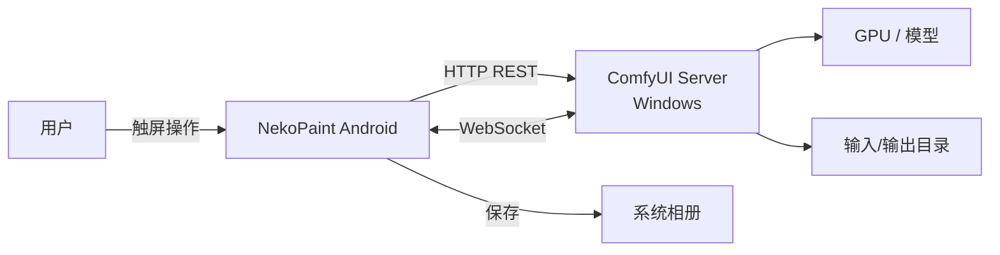
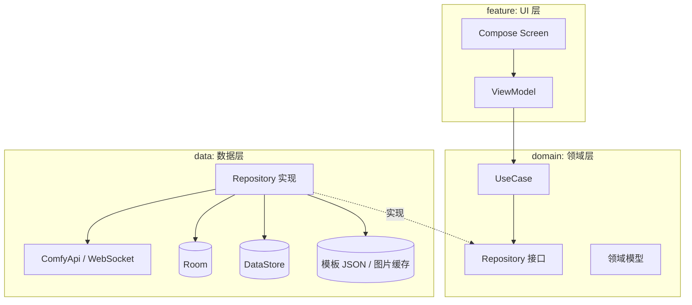
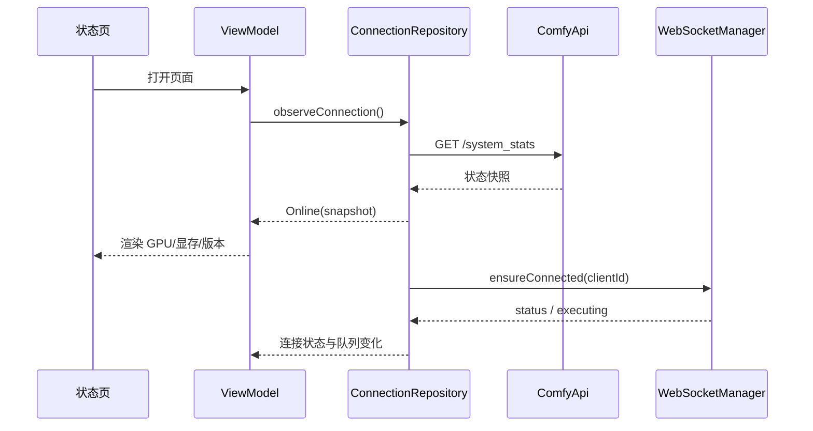
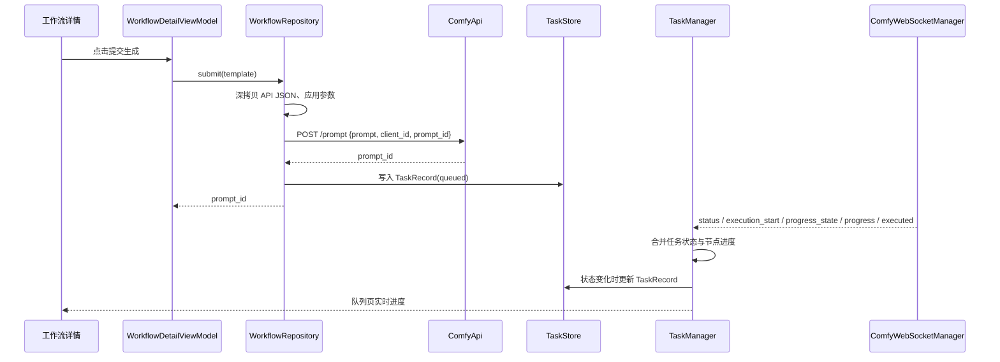
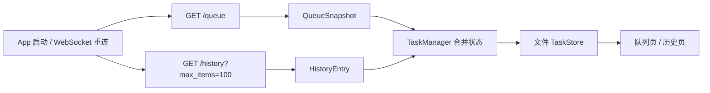

# ARCHITECTURE.md

> 技术架构与工程结构
>
> - 版本：v0.1（草案）
> - 更新：2026-11-04
> - 状态：待项目负责人确认
> - 关联文档：`REQUIREMENTS.md`、`COMFYUI_API.md`、`DECISIONS.md`

---

## 1. 架构目标

1. 手机只做“控制与展示”，所有生成在 Windows 的 ComfyUI 上完成。
2. 网络、数据、UI 分层，避免 Activity/Fragment 里堆逻辑。
3. 对 ComfyUI 版本差异保持容错：字段缺失不崩溃，能力不支持时降级。
4. 单模块即可维护；不为未来可能的需求提前拆多模块。
5. 每个阶段都能独立构建、运行、验收。

### 关键约束

- Android 原生：Kotlin + Jetpack Compose + Material 3。
- 局域网直连 ComfyUI，无中转服务。
- 最低 Android 8.0（API 26），目标 API 37（以创建工程时稳定版为准）。
- V1 不引入账号体系、云端、数据库服务端。

---

## 2. 系统上下文



- App 与 ComfyUI 在同一局域网。
- ComfyUI 默认端口 `8188`，通过 `--listen` 暴露到局域网。
- 无额外后端、无云服务。

---

## 3. 技术选型

| 领域 | 选型 | 状态 | 说明 |
| --- | --- | --- | --- |
| 语言 | Kotlin 2.x | 确定 | Android 官方主推 |
| UI | Jetpack Compose + Material 3 | 确定 | 声明式 UI，适合状态驱动 |
| 导航 | Navigation Compose | 建议 | 单 Activity，多 Composable 页面 |
| 异步 | Coroutines + Flow | 确定 | 结构化并发，替代回调 |
| 状态 | ViewModel + StateFlow + UDF | 建议 | UI 状态不可变，事件单向 |
| HTTP | Retrofit + OkHttp | 建议 | 成熟、资料多；WebSocket 复用 OkHttp |
| JSON | kotlinx.serialization | 建议 | 与 Kotlin 类型安全结合，容错配置方便 |
| WebSocket | OkHttp WebSocket | 建议 | 与 HTTP 共用连接池与超时配置 |
| 图片加载 | Coil 3 | 建议 | Compose 友好，支持磁盘/内存缓存与采样 |
| 本地配置 | DataStore (Preferences) | 建议 | 轻量键值，适合服务器配置 |
| 结构化数据 | Room | 建议 | 模板、绑定、任务、历史元数据 |
| 依赖注入 | 手动 `AppContainer` | 建议 | 初期简单透明；规模变大再评估 Hilt |
| 测试 | JUnit + MockWebServer + Turbine + Compose UI Test | 建议 | 解析器与仓库优先覆盖 |
| 构建 | Gradle Kotlin DSL + Version Catalog | 建议 | `libs.versions.toml` 统一版本 |

> 版本号不在文档中写死；创建工程时使用当时最新稳定版，并记录到 `gradle/libs.versions.toml`。
> 替代方案与理由见 `DECISIONS.md`。

---

## 4. 应用分层



### 依赖规则

- `feature` 只能依赖 `domain` 和 `core/ui`。
- `domain` 不依赖 Android 框架（除协程等纯 Kotlin 库）。
- `data` 实现 `domain` 的仓库接口，可以依赖 Android、Retrofit、Room。
- `core/network` 只放传输与 DTO，不放业务规则。
- UI 不直接接触 DTO；由 mapper 转为领域模型。
- ViewModel 不持有 `Context`、`Activity`、`View`。

### 为什么不用多模块

当前只有一名开发者、一个 App、一个数据源。多模块会增加构建配置与依赖管理成本，收益不足。
当出现以下情况再拆分：第二个客户端、复杂后台服务、构建时间明显变长、多人并行开发。

---

## 5. 目标目录结构

> 以下为计划结构，当前尚未创建 Android 工程。

```text
NekoPaint/
├─ AGENTS.md
├─ PRODUCT.md
├─ REQUIREMENTS.md
├─ ARCHITECTURE.md
├─ COMFYUI_API.md
├─ ROADMAP.md
├─ DECISIONS.md
├─ .gitignore
├─ settings.gradle.kts
├─ build.gradle.kts
├─ gradle/
│  ├─ libs.versions.toml
│  └─ wrapper/
└─ app/
   ├─ build.gradle.kts
   ├─ proguard-rules.pro
   └─ src/
      ├─ main/
      │  ├─ AndroidManifest.xml
      │  ├─ res/
      │  │  ├─ values/strings.xml
      │  │  ├─ values/themes.xml
      │  │  ├─ xml/network_security_config.xml
      │  │  └─ xml/file_paths.xml
      │  └─ java/io/github/xiaowu20245/nekopaint/
      │     ├─ NekoPaintApplication.kt
      │     ├─ MainActivity.kt
      │     ├─ di/
      │     │  └─ AppContainer.kt
      │     ├─ core/
      │     │  ├─ common/          # Result、AppError、DispatcherProvider、常量
      │     │  ├─ network/         # ComfyApi、DTO、OkHttp、WebSocket、错误映射
      │     │  ├─ datastore/       # ServerConfigStore
      │     │  ├─ database/        # AppDatabase、DAO、Entity
      │     │  ├─ files/           # 模板 JSON、图片缓存、MediaStore
      │     │  ├─ model/           # 领域模型
      │     │  └─ ui/              # theme、通用组件、导航
      │     ├─ data/
      │     │  ├─ mapper/          # DTO <-> 领域模型
      │     │  └─ repository/      # 仓库实现
      │     ├─ domain/
      │     │  ├─ repository/      # 仓库接口
      │     │  └─ usecase/         # 组合业务逻辑
      │     └─ feature/
      │        ├─ onboarding/      # 首次配置引导
      │        ├─ server/          # 服务器配置 + 状态面板
      │        ├─ workflow/        # 模板列表、导入、详情
      │        ├─ parameters/      # 参数表单
      │        ├─ generate/        # 生成子页（从工作流进入）
      │        ├─ queue/           # 队列与进度
      │        ├─ history/         # 历史子页（从队列进入）
      │        ├─ gallery/         # 图片预览与保存
      │        ├─ canvas/          # 单图蒙版重绘（V0.5）
      │        └─ settings/        # 设置、关于、缓存
      └─ test/
         ├─ java/...              # 单元测试
         └─ resources/fixtures/   # 真实接口 JSON 样本（脱敏）
```

### 包名

已确认：`io.github.xiaowu20245.nekopaint`（见 `DECISIONS.md` D-018）。

### 主导航

底部固定四个板块：

| 板块 | 职责 |
| --- | --- |
| 服务器 | 连接配置、在线状态、GPU/显存 |
| 工作流 | 模板列表、导入、详情、参数入口 |
| 队列 | 运行中/等待中任务，历史入口 |
| 设置 | 主题、缓存、安全提示、关于 |

“生成”和“历史”不作为底部 tab：生成从工作流详情进入，历史从队列页进入。顶部 App Bar 只显示当前板块标题；V0.1 可在右侧增加连接状态小圆点。

---

## 6. 核心数据流

### 6.1 连接与状态



要点：

- HTTP 用于一次性快照；WebSocket 用于持续事件。
- App 回到前台触发一次健康检查；离开页面停止轮询。
- 连接状态由 Repository 统一维护，多个页面共享同一个 `StateFlow`。

### 6.2 提交任务与实时进度（V0.3 已实施）



要点：

- 提交前深拷贝模板 JSON，应用参数后提交，绝不修改原模板。
- `client_id` 由 `ClientIdStore` 持久化，POST 与 WebSocket 共用同一个值。
- `TaskManager` 是单例（在 `AppContainer` 中创建），统一处理 WebSocket 事件、队列快照和历史快照。
- 进度以 `progress_state` 为主、`progress` 为细粒度补充，`executing` 提供当前节点。
- 任务状态只允许单向收敛：`queued → running → success / failed / interrupted`。

### 6.3 队列、历史与恢复（V0.3 已实施）



- 服务器队列与历史是最终事实来源；本地 `TaskRecord` 保存提交参数快照与名称。
- 断线时队列页降到 2 秒轮询；重连成功后主动刷新一次。
- 历史状态同时看 `status_str` 和事件消息：`execution_interrupted` 优先于 `status_str=error`，避免把中断误判成失败。
- 历史详情支持用参数快照“再次生成”，新任务不会覆盖原历史。

---

## 7. 网络层设计

### 7.1 Base URL 与 Retrofit

- 用户配置保存为 `scheme`、`host`、`port`，运行时拼成 `http://host:port/`（Retrofit 要求尾斜杠）。
- 配置变化时重建 Retrofit 实例；共享 OkHttpClient。
- IPv6 主机需要方括号：`http://[fe80::1]:8188/`。
- 不使用全局单例保存旧地址，避免切换服务器后请求打错目标。

### 7.2 API 接口（计划）

```kotlin
interface ComfyApi {
    @GET("system_stats")
    suspend fun systemStats(): SystemStatsDto

    @GET("queue")
    suspend fun queue(): QueueDto

    @GET("history")
    suspend fun history(
        @Query("max_items") maxItems: Int? = null,
        @Query("offset") offset: Int? = null,
    ): Map<String, HistoryItemDto>

    @GET("history/{promptId}")
    suspend fun historyItem(@Path("promptId") promptId: String): Map<String, HistoryItemDto>

    @POST("prompt")
    suspend fun submitPrompt(@Body body: PromptRequestDto): PromptResponseDto

    @POST("interrupt")
    suspend fun interrupt(@Body body: InterruptRequestDto): Response<Unit>

    @POST("queue")
    suspend fun updateQueue(@Body body: QueueOperationDto): Response<Unit>

    @GET("view")
    suspend fun viewImage(
        @Query("filename") filename: String,
        @Query("subfolder") subfolder: String?,
        @Query("type") type: String?,
    ): ResponseBody

    @GET("object_info")
    suspend fun objectInfo(): Map<String, NodeInfoDto>

    @GET("models")
    suspend fun modelFolders(): List<String>

    @GET("models/{folder}")
    suspend fun models(@Path("folder") folder: String): List<String>
}
```

约定：

- 错误响应体需要解析时使用 `Response<T>` 或捕获 `HttpException` 后读取 `errorBody`。
- JSON 配置 `ignoreUnknownKeys = true`、`isLenient = true`、`explicitNulls = false`。
- 所有 DTO 字段按“可能缺失”设计，不假设版本一致。
- 图片下载使用独立 OkHttp 请求或 Coil，不经过 JSON 解析。

### 7.3 超时与重试

| 项目 | 值 | 说明 |
| --- | --- | --- |
| 连接超时 | 5s | 局域网应很快 |
| 普通读取 | 15s | `/prompt` 校验可能稍慢 |
| 图片下载 | 30s | 大图 |
| WebSocket 心跳 | 20s | OkHttp `pingInterval` |
| WS 重连退避 | 1, 2, 4, 8, 16, 30s | 加 0–500ms 抖动 |
| 状态轮询 | 5s | 仅页面可见时 |
| 队列降级轮询 | 2s | WS 不可用时 |

只对幂等 GET 自动重试；`POST /prompt` 不自动重试，除非能保证幂等（客户端 `prompt_id`）。

### 7.4 WebSocket 管理

职责：

- 使用配置生成 `ws://host:port/ws?clientId=<uuid>`（HTTPS 时 `wss://`）。
- 维护连接状态：`Disconnected / Connecting / Connected / Reconnecting`。
- 解析文本事件与二进制预览帧；未知事件忽略并记录 Debug 日志。
- 断线重连；重连后重新拉取队列与历史。
- 页面不可见时暂停轮询；WebSocket 保持应用级连接。
- 提供 `Flow<ComfyEvent>` 给 `TaskManager`。
- 事件解析已拆到 `ComfyEventParser`，坏 JSON / 未知事件返回 `null`，二进制帧直接忽略。

关键点：

- **clientId 必须与提交任务时的 `client_id` 一致。** 否则服务端只把事件发给提交者，App 会“看不到自己的任务”。
- 服务端在连接建立时发送 `status`；重连时若当前执行客户端是自己，会补发 `executing`。
- 0.27.0 会发送 `progress_state`（节点状态累计快照）；App 以它作为节点状态主来源，`progress` 作为细粒度补充。
- 二进制帧格式：4 字节事件类型 + 数据。`1` = 预览图（4 字节图片类型 + 图片字节，1=JPEG、2=PNG）；`3` = 文本；`4` = 带元数据预览。V0.3 可先忽略二进制帧。

### 7.5 错误模型

```kotlin
sealed interface AppError {
    data object NoServerConfigured : AppError
    data object NetworkUnreachable : AppError
    data object Timeout : AppError
    data class Http(val code: Int, val message: String?) : AppError
    data class ServerValidation(val summary: String, val nodeErrors: List<NodeError>) : AppError
    data class Parse(val detail: String) : AppError
    data class Unknown(val detail: String) : AppError
}
```

- Mapper 将异常/HTTP 状态转为 `AppError`，ViewModel 再映射为中文文案。
- 不在 UI 直接显示异常堆栈。
- 诊断信息可复制，但移除服务器地址、提示词正文、图片路径。

---

## 8. 状态管理

### 8.1 单向数据流

```kotlin
data class ServerUiState(
    val connection: ConnectionUiState = ConnectionUiState.Loading,
    val stats: SystemStats? = null,
    val lastUpdated: Instant? = null,
    val isRefreshing: Boolean = false,
)

sealed interface ServerEvent {
    data class ShowMessage(val message: String) : ServerEvent
    data class Navigate(val route: Route) : ServerEvent
}
```

- ViewModel 暴露 `StateFlow<UiState>` 与 `SharedFlow<Event>`。
- Composable 只渲染状态、发送意图，不直接调用 Repository。
- 一次性提示（Snackbar、跳转）用事件，避免旋转屏幕重复弹出。

### 8.2 共享状态

跨页面共享：

- 当前服务器与连接状态（`ConnectionRepository`）。
- 当前模板草稿（`DraftRepository` 或数据库）。
- 正在运行的任务（`TaskRepository`）。

每个页面只订阅自己需要的切片，避免一个大 `AppState` 引发全量重组。

---

## 9. 持久化设计

### 9.1 DataStore

保存轻量配置：

- 当前服务器 ID。
- 主题模式、动态取色开关。
- 是否已看过安全提示/引导。
- 缓存上限。

### 9.2 模板存储（V0.2a 已实施）

模板 JSON 与参数绑定暂存文件系统：

```text
filesDir/workflows/<templateId>/api.json      # 原始 API JSON，只读
filesDir/workflows/<templateId>/profile.json  # 名称、哈希、候选参数、选中状态
filesDir/tasks/<promptId>.json                # 提交后的任务记录（含参数快照与状态）
```

选中的参数就是简单模式显示的字段；高级模式读取同一份 `profile.json` 的全部候选。
任务记录在状态变化时由 `TaskManager` 更新，应用重启后重新读取。
固定 `client_id` 保存在独立 DataStore（`client_identity`），不写入模板文件。
Room 仍未引入；历史列表直接来自 `/history`，本地任务记录用文件存储。V0.4 评估缓存与分页时再决定是否迁移。

### 9.3 Room 表（后续）

```text
server_profile
  id TEXT PK, name TEXT, scheme TEXT, host TEXT, port INTEGER,
  created_at INTEGER, updated_at INTEGER

workflow_template
  id TEXT PK, name TEXT, json_path TEXT, source_format TEXT,
  node_count INTEGER, created_at INTEGER, updated_at INTEGER

workflow_binding
  id TEXT PK, template_id TEXT, node_id TEXT, input_name TEXT,
  label TEXT, type TEXT, group_name TEXT, sort_order INTEGER,
  default_value_json TEXT, constraints_json TEXT, visible INTEGER

template_draft
  template_id TEXT PK, values_json TEXT, updated_at INTEGER

task_record
  prompt_id TEXT PK, template_id TEXT, client_id TEXT,
  status TEXT, queue_number INTEGER, submitted_at INTEGER,
  started_at INTEGER, finished_at INTEGER,
  params_json TEXT, error_json TEXT

task_output
  id TEXT PK, prompt_id TEXT, node_id TEXT,
  filename TEXT, subfolder TEXT, type TEXT,
  local_path TEXT, width INTEGER, height INTEGER
```

- 模板 JSON 存文件（`filesDir/workflows/<id>.json`），数据库存路径与元数据。
- 图片缓存存 `cacheDir/comfy-images/`，按 URL 哈希命名；保存到相册时走 MediaStore。
- 删除模板时同时删除 JSON、绑定、草稿；历史任务保留但标记模板已删除。
- 使用事务保证“模板 + 绑定”一起成功或失败。

### 9.3 数据保留

- 历史元数据默认保留最近 200 条，超出按时间清理。
- 图片缓存默认上限 500 MB，LRU 清理。
- 提供“清理缓存”，不删除相册图片。

---

## 10. 工作流模板与参数绑定

### 10.1 导入

1. 通过 SAF 读取文件流（限制大小）。
2. 解析为 `JsonObject`。
3. 判断格式：
   - API 格式：所有 value 是对象且含 `class_type`。
   - UI 格式：含 `nodes` 数组与 `links` 数组。
4. API 格式写入文件并生成模板记录；UI 格式拒绝并给出导出指引。

### 10.2 绑定模型

```kotlin
data class ParameterBinding(
    val id: String,
    val nodeId: String,
    val inputName: String,
    val label: String,
    val type: ParameterType,
    val group: ParameterGroup,
    val defaultValue: JsonElement,
    val constraints: ParameterConstraints,
)

enum class ParameterType { TEXT, MULTILINE_TEXT, INT, FLOAT, BOOLEAN, ENUM, IMAGE }

data class ParameterConstraints(
    val min: Double? = null,
    val max: Double? = null,
    val step: Double? = null,
    val options: List<String> = emptyList(),
)
```

- 绑定按 `nodeId + inputName` 定位，节点标题只用于展示。
- 自动识别使用 `class_type` 白名单；无法识别时允许手动添加。
- 应用参数时校验类型：文本→String，整数→Int/Long，小数→Double，枚举→String，布尔→Boolean。
- 保留 `_meta.title` 作为显示名；缺失时用 `class_type`。

### 10.3 提交时应用参数

```text
templateJson (只读)
   └─ deepCopy
        └─ for each (binding, value):
              prompt[nodeId].inputs[inputName] = value
        └─ prompt["client_id"]? 不放入 prompt，放在请求顶层
        └─ POST { "prompt": copy, "client_id": uuid }
```

- 不把 `client_id` 写进节点图。
- 若服务器支持客户端指定 `prompt_id`，可传入 UUID 以实现幂等重试（版本相关，待验证）。
- 提交前做“节点类型存在性”检查（可选，依赖 `/object_info`）。

---

## 11. 图片处理

- 列表：Coil 请求 `/view` URL，指定尺寸采样；磁盘缓存由 Coil 管理或自定义。
- 大图：使用 `SubcomposeAsyncImage`/自定义 painter，按屏幕尺寸解码；缩放用 `graphicsLayer`，不重复解码。
- 保存：下载原始字节 → MediaStore `Pictures/NekoPaint`；文件名含时间与短 prompt_id。
- 分享：写入 `cacheDir/share/`，通过 `FileProvider` 授权临时 URI。
- 元数据：PNG 的 `prompt`/`workflow` 文本可选读取，仅展示，不执行。
- 内存：避免在 `LazyColumn` 中持有 Bitmap；使用 Coil 内存缓存并限制比例。

---

## 12. 安全设计

- **传输**：默认 HTTP，仅在可信局域网使用；设置页常驻风险提示。若未来支持 HTTPS，允许用户选择 `https` 并处理自签名证书（需单独决策，不能默认信任所有证书）。
- **认证**：ComfyUI 默认无认证。App 不内置账号；如未来加 Token，使用 DataStore + Android Keystore 加密，禁止明文。
- **日志**：Release 禁用 HTTP 日志；Debug 日志移除 `prompt`、图片 base64、服务器完整地址。
- **备份**：`android:allowBackup="false"` 或备份规则排除 DataStore/数据库，避免配置泄露。
- **组件**：`MainActivity` 之外不导出；FileProvider 仅授权必要路径。
- **网络安全配置**：因服务器 IP 不固定，需要允许明文流量；通过 `network_security_config.xml` 明确声明，并在代码注释说明原因。
- **输入校验**：主机/端口严格校验，避免 URL 注入；文件导入限制大小与类型。

---

## 13. 并发与生命周期

- 所有网络调用在 `Dispatchers.IO`；UI 只在主线程。
- 使用 `viewModelScope`；Repository 内部使用 `SupervisorJob` 管理长连接。
- WebSocket 生命周期与应用前台状态绑定；不因单个页面销毁而断开全局连接，但页面级订阅要取消。
- 进程被杀后：未完成任务从数据库恢复，重连后以服务器历史校准。
- 长任务不依赖前台服务（V1 已确认）；锁屏后可能收不到实时进度，回到前台自动补齐。

---

## 14. 测试策略

| 层级 | 工具 | 覆盖内容 |
| --- | --- | --- |
| 单元 | JUnit | 工作流格式识别、参数绑定、类型转换、错误映射、退避计算 |
| 网络 | MockWebServer | `/prompt` 成功/400、`/history` 解析、超时、空响应 |
| WebSocket | MockWebServer WebSocket | 事件解析、断线重连、未知事件忽略 |
| 数据 | Room in-memory | 模板/绑定/任务事务、状态收敛 |
| UI | Compose UI Test | 表单校验、空状态、错误状态、导航 |
| 手工 | 真机 + 真实 ComfyUI | 连接、提交、进度、中断、保存、断网恢复 |

### 必须保留的测试样本

在 `app/src/test/resources/fixtures/` 保存脱敏后的真实响应：

- `system_stats.json`
- `queue_running_pending.json`
- `history_success.json`
- `history_error.json`
- `prompt_response.json`
- `prompt_validation_error.json`
- `ws_status.json`、`ws_progress_state.json`、`ws_progress.json`、`ws_executed.json`、`ws_error.json`
- `workflow_api_t2i.json`、`workflow_api_inpaint.json`

这些样本是防止“接口改了就悄悄坏掉”的第一道防线。

---

## 15. 构建与质量

- Gradle Kotlin DSL + Version Catalog。
- `debug` 与 `release` 两个构建类型；release 开启 R8，保留 kotlinx.serialization 规则。
- `compileSdk` / `targetSdk` 以创建时最新稳定版为准；`minSdk 26`。
- 开启 Compose compiler metrics（可选，仅本地）。
- Lint：`abortOnError` 保持默认；不随意 suppress。
- 依赖版本集中在 `libs.versions.toml`；新增依赖需说明理由。
- 签名文件不入库；使用本机 `keystore.properties`（加入 `.gitignore`）。

---

## 16. 可演进方向

当真实需求出现时再考虑：

- 多模块拆分（`core:network`、`feature:*`）。
- Hilt 替换手动 DI。
- 前台服务/WorkManager 保证后台进度。
- Windows 中转服务（解决文件浏览、鉴权、HTTPS、公网访问）。
- 自动发现（mDNS/自定义广播）——ComfyUI 本身不广播，需要额外方案。
- UI 格式工作流转换器。
- 多服务器与快速切换。
- 端到端加密/Token 认证。

任何一项落地前，先在 `DECISIONS.md` 新增 ADR。

---

## 17. 相关决策

- D-001 Android 原生技术栈
- D-002 局域网直连、无中转
- D-004 单模块 + 分包
- D-006 手动依赖注入
- D-007 Retrofit + OkHttp + kotlinx.serialization
- D-008 DataStore + Room
- D-009 仅支持 API 格式工作流
- D-011 client_id 与 WebSocket 一致
- D-013 明文 HTTP 与网络安全配置
- D-014 minSdk 26 / target 37
- D-018 包名 `io.github.xiaowu20245.nekopaint`
- D-019 单图蒙版重绘
- D-020 模型管理只读
- D-022 V1 单服务器
- D-025 本地工作流仅手动导入

完整列表与理由见 `DECISIONS.md`。
